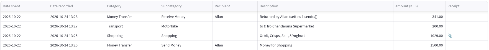
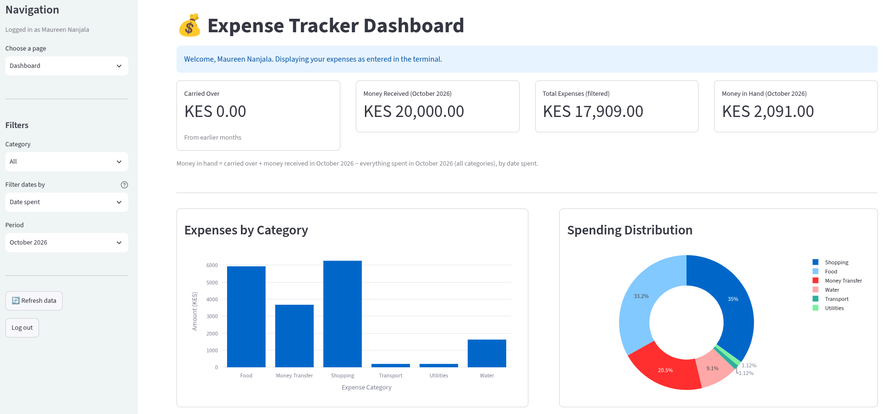
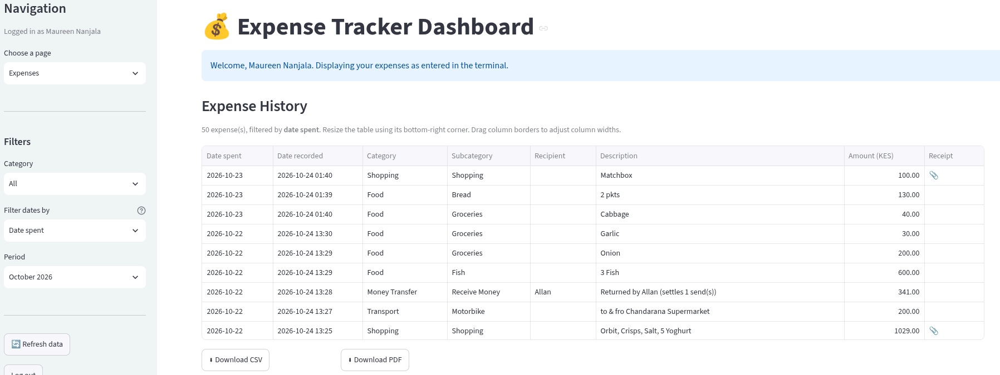
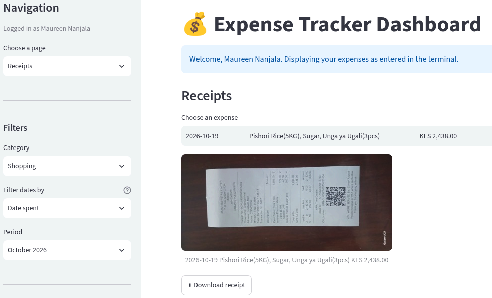
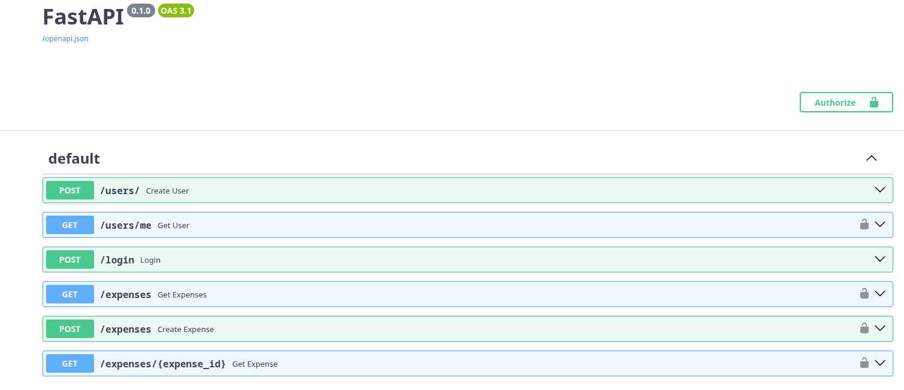

# Expense-tracker python app

## Project Goal

This project demonstrates recording of various expenses in my household to be able to make sound decisions on how to manage my finances by it eventually giving information on what expense category has the most and least spending and are they necessary or can changes be made to ensure reasonable spending.

## Tools

There are 3 interfaces that share one PostgreSQL database:

| Interface           | Purpose                                                                         |
| ------------------- | ------------------------------------------------------------------------------- |
| Terminal App        | Register, log in, record money received, add expenses, view balance and history |
| Streamlit Dashboard | Read-only charts, tables, receipts and CSV/PDF export                           |
| FastAPI             | Token-protected endpoints for users and expenses                                |

## Techstack

Python, PostgreSQL via docker, Argon2, Streamlit, Plotly, pandas, ReportLab, FastAPI and JWT.

## Project structure

This is how the expense-tracker project is structured.

```text
expense-tracker/
├── Login.py                 # terminal entry point
├── README.md
├── schemas.sql              # database tables
├── .env                     # local secrets; never commit
├── .env.example
├── Dockerfile
├── compose.yaml
├── .github/
│   └── workflows/
│       └── ci.yml
├── .gitignore
├── .dockerignore
├── src/
    ├── __init__.py
    ├── api/
    │   ├── main_api.py
    │   ├── models.py
    │   └── schemas.py
    ├── auth_service.py      # registration and login
    ├── database.py          # database connection
    ├── ui_helpers.py        # countdown animation
    ├── user_config.py       # attempts, delay and lockout
    ├── user_repository.py   # ID generation and viewing details
    ├── user_security.py     # Argon2id hashing
    ├── expense_dashboard.py # Streamlit dashboard
    ├── images/              # receipts from Streamlit dashboard
    └── expenses/
        ├── init.py
        ├── expense_menu.py
        ├── expense_categories.py
        ├── expense_config.py
        ├── expense_factory.py
        ├── expense_reports.py
        ├── expense_service.py
        └── expense_utils.py
└── tests/
    └── smoke_test.py
```

### Prerequisites

- Python 3.12-slim or newer
- Docker Desktop with Docker Compose

## Run with Docker Compose

If you do not already have a `.env`, copy `.env.example` to `.env` and replace the sample password/secret values. If `.env` already exists, keep it and add `PGADMIN_DEFAULT_EMAIL` and `PGADMIN_DEFAULT_PASSWORD` to it instead of overwriting it. Do not commit `.env`.

```powershell
docker compose up --build -d
docker compose ps
```

The Compose stack starts PostgreSQL, FastAPI, the Streamlit dashboard and pgAdmin. PostgreSQL uses a named volume, so its data survives container rebuilds. `schemas.sql` is mounted as a PostgreSQL initialization script and runs only when PostgreSQL initializes an empty data volume; it is not rerun on each `up`.

### Open the services

| Service | Address | Sign-in / use |
| --- | --- | --- |
| FastAPI | <http://localhost:8000> | API base URL |
| FastAPI Swagger UI | <http://localhost:8000/docs> | Explore and call endpoints |
| Streamlit dashboard | <http://localhost:8501> | Sign in with an app User ID and PIN |
| pgAdmin | <http://localhost:5050> | Sign in with `PGADMIN_DEFAULT_EMAIL` and `PGADMIN_DEFAULT_PASSWORD` from `.env` |

In pgAdmin, register a server connection with host `postgres`, port `5432`, maintenance database `DB_NAME`, and username/password `DB_USER`/`DB_PASSWORD` from `.env`. Use `postgres` as the host from inside Compose; `localhost` is for tools running on the host machine.

Run the interactive terminal app in a container with:

```powershell
docker compose run --rm cli
```

Stop the services with `docker compose down`. This keeps database and pgAdmin data. To delete the database data as well, use `docker compose down --volumes`—this is destructive.

## Call the API with Thunder Client

Install the Thunder Client VS Code extension and create a local Thunder Client environment with `baseUrl` set to `http://localhost:8000`.

1. Send `POST {{baseUrl}}/users/` with JSON:
   ```json
   {
     "full_name": "Test User",
     "email": "your-unique-test-address@example.com",
     "pin": "482917"
   }
   ```
   Use a unique email and a six-digit PIN that is not one of the rejected weak PINs. Keep the returned `user_id` in a local environment only.
2. Send `POST {{baseUrl}}/login` with `{"user_id":"<returned-user-id>","pin":"482917"}`. Copy `access_token` from the response.
3. Call `GET {{baseUrl}}/users/me` or `GET {{baseUrl}}/expenses` with an **Authorization: Bearer** header containing that token.
4. To create an expense, send `POST {{baseUrl}}/expenses` with the same Bearer token and JSON such as:
   ```json
   {
     "category": "Food",
     "subcategory": "Groceries",
     "description": "Test purchase",
     "amount": "12.34"
   }
   ```

Do not commit test PINs, access tokens, or Thunder Client environment values. Swagger UI at <http://localhost:8000/docs> is another way to explore the API.

## GitHub Actions CI and image publishing

The workflow in `.github/workflows/ci.yml` runs for pushes and pull requests targeting `Mini-Projects`. It validates the Compose configuration, builds and starts PostgreSQL, the API, dashboard, and pgAdmin, then runs `tests/smoke_test.py`. The smoke test checks that the dashboard and API start, then tests registration, login, authenticated user lookup, and expense creation/read-back against the real PostgreSQL service. No production credentials are needed; the workflow uses disposable CI-only credentials.

To enable and use it:

1. Push this project to a GitHub repository, including `Dockerfile`, `compose.yaml`, `schemas.sql`, `.env.example`, `tests/smoke_test.py`, and `.github/workflows/ci.yml`. Do not push `.env`.
2. In GitHub, open **Settings → Actions → General** and allow the repository to run the listed actions.
3. Open a pull request targeting `Mini-Projects` from any branch, or push directly to `Mini-Projects`. Open the repository's **Actions** tab and inspect the **CI** run; a failure includes the Compose service logs.
4. Merge or push to `Mini-Projects`. After the integration job passes, the workflow builds the shared app image and publishes SHA-tagged and `latest` images to GitHub Container Registry (GHCR). The first package may be private; grant the deployment host access to pull it or change its visibility in the package settings.
5. To deploy that image, configure the destination machine with the same required application/database environment variables in its untracked `.env`, set `APP_IMAGE=ghcr.io/<owner>/expense-tracker:<commit-sha>`, log the machine in to GHCR if the package is private, then run `docker compose pull` and `docker compose up -d`. Keep a persistent PostgreSQL volume and back it up.

This workflow provides CI and CD to the image registry. Deploying automatically onto a server or cloud service requires choosing that deployment target and adding its deployment credentials/secrets; do not put those credentials in the workflow file.

### Optional: run the application directly on the host

Create and activate a virtual environment, then install dependencies:

```powershell
python -m venv venv
.\venv\Scripts\Activate.ps1
pip install -r requirements.txt
```

Configure `.env` with credentials for a PostgreSQL server reachable from the host (for a local Compose database, use `localhost` for `DB_HOST` and publish PostgreSQL's port in Compose). Set `JWT_SECRET_KEY` to a randomly generated secret. Then launch the terminal app with `python Login.py`; launch the API with `uvicorn src.api.main_api:app --host 127.0.0.1 --port 8000`, or the dashboard with `streamlit run src/expense_dashboard.py`.

### Database schema

In the Docker setup, `schemas.sql` is automatically run when the PostgreSQL data volume is initialized for the first time. For a manually managed database, run it once with pgAdmin's Query Tool or `psql -d <database> -f schemas.sql`.

There are 3 tables created:\
(i) `users` - records information about the users.\
(ii) `income` - records the distinguished amount either by Salary or Top-Up entered by the successfully logged in user.\
(iii) `expenses` - records the money spent on various expenses by the successfully logged in user.

## Initialize the Expense-tracker app

Open the terminal and run: `python Login.py`

Then one is provided with 4 options which include Register, View Registered details, Login and Exit.

If one selects option "**`1`**" which is `Register`, one will need to enter their full name, email then enter a created 6 digit PIN which one will be prompted to re-enter the PIN as confirmation.

One will be presented with an 8-digit ID that they will be required to remember as it will come handy in the login section. Then the Sign Up/Register process will be complete.

If one selects option "**`2`**" which is `View registered details`, input your ID that you were supplied after the Registration process to see all information about you excluding the PIN.

If one selects option "**`3`**" which is `Login`, one will be required to input their ID and correct PIN that they had created during the registration process.

If the Login is successful they will be redirected to the expense menu.

### Security for both Registration and Login

There are some rules that have been enforced on both Registration and Login in the file: `auth_service.py`

(i) The PIN created in the registration and login process must be 6 digits and must be only numbers(no special characters, no letters).

There is a set of weak PINS that has been described so if you the user enters one of them, it will not be accepted.

(ii) During the login process if you the user enters the password wrong 3 times then the account will be locked for a duration of time and during that duration you will not be able to login until it ends.

If you enter 1 or 2 wrong PIN attempts, and on the next attempt you enter the correct PIN attempt then the failed_attempts will be reset to 0.

The configuration for the max attempts, retry delay and lockout time are in the file: `user_config.py`

Of course the PIN is hashed using argon2id cryptography method and the file responsible is: `user_security.py`

There is a file: `user_repository.py` :\
This file is responsible for random generation of the 8-digit ID that is displayed after a successful registration process.\
It is also responsible for viewing registered details which is option "2".

## Expense menu

The file: `expense_menu.py`

Here since it is someone's first time a message appears saying "No money has been recorded yet" then asks the user if they would like to record it giving them yes or no choices.

For first time users select **"_y_"**, for continuing users, assuming one had already recorded it previously the other options are presented to you(basically no message).

The idea behind this is that one of the options was that a user can enter their salary and the other was what if the money was sent from elsewhere for spending hence a top-up option was added.

A single “monthly salary” number can’t represent “money arrived on the 9th November 2026, ran out on the 24th November 2026, more arrived later” because in this situation the person is sending a part of their salary somewhere else where the money ends up being spent on various things.\
There is no specific rule like the money is from 1st-30th November 2026. When the money ends whenever it does, the person sends more(top-up).

So at this juncture select option "**`1`**": **`Record Money Received`**. There are 2 options presented:\
(i) If one selects "**`1`**" Salary then they will enter the amount, date they received the money and a description like section to say who one received that money from.\
(ii) If one selects "**`2`**" Top-up then they will enter the amount, date they received the money and a description like section to say who one received that money from.

NB: When entering the date received, the date will not be accepted if it is from the future. The format is YYYY-MM-DD.

Then Select option "**`2`**": **`Add Expense`**:
Here the user will be able to view a list of various expenses.\
Some expenses have Sub-Categories while others are direct(select expense then enter the amount).\
In this part after selecting an expense the amount spent, one is allowed to enter a brief description of spending of that particular expense and also required to confirm(select "y") or reject(select "n") for that particular expense to be saved.

The logic behind money in hand is that for any date it is all money ever received up to that date minus all money ever spent up to that date.\
Unspent money from November 2026 becomes December’s 2026 opening balance and an overspend carries forward as a negative opening balance.

E.g., Callum received 10000 in November 2026, spent 7000 on expenses in that month remaining with 3000.\
In December 2026, he receives 6500 so that balance that he had in November carried over to December hence in December he has 6500 + 3000 = 9500.

The logic behind the money transfer expense is that one might have money but then from that they send the money to someone else to spend on various expenses which will be recorded by the app.\
Do not confuse this with the earlier explanation under option "1". In this case this is not salary or top-up.

E.g., Maureen has 6000 left and sends to Kate 2700 and Maureen gets left with 3300.\
Kate spends 2500 on shopping therefore needing to return a balance of 200 to John hence the total expense ends up being a net of returns.\
Send money is a normal expense that lowers the money in hand(current money that Maureen has).\
Suppose Maureen is the user, in the database this will be captured as send money in one row and receive money having settling that particular send in another row.\
The balance that Maureen is left with is 3300 + 200 = 3500.\
Received amount is stored as a positive number and every calculation treats it as a credit.



In the terminal before Maureen would want to record the returned money(return the balance) if any was left, the send money would be stashed as pending until the return has been successfully settled.

If one selects option "**`3`**": **`View Balance`**:\
Here the user views the remaining balance left after spending it on expenses from the initial Salary or Top-Up that was entered.

If one selects option "**`4`**": **`View expense history`**:\
Here the user is able to view a history of the summary of recorded expenses as not all columns or rows(limited to 50) from the database are included here just a few for simplicity so that the user will be able to understand as this will still be in the terminal.

## Streamlit dashboard

Please note that the dashboard is only for viewing not for adding, deleting or updating expenses.

The user has to use the same login credentials from the terminal to login into the Streamlit dashboard, be able to view dashboards and filter dates based on custom range dates and export Expenses table as csv or pdf.

Expenses by category and sub-category with the date the money was spent(backdating allowed) and the date it was recorded.

Money in hand with carry-over between months.

Money Transfer: send money to someone then settle it when they return the balance.

There are:\
(i) `dashboard` page



(ii) `Expenses` page - table with required columns to see view the user expenses. It can be downloaded as csv or pdf format.



(iii) `Receipts` page - receipts especially if shopping was done it is stored here. It can be downloaded as jpg, jpeg, png, heic formats.



## API

An actual endpoint for adding expenses, validating the submitted data and storing it in a database was created using FastAPI.

These are the files:

| Files               |
| ------------------- |
| **`main_api.py`**     |
| **`models.py`**       |
| **`schemas.py`**      |
| **`api_database.py`** |

Authentication has been added to both users and expenses endpoints.

This is logic behind the login endpoint:

- Receive the eight-digit ID and 6 digit PIN.
- Find the account by ID.
- Check whether the account is currently locked.
- Verify the submitted PIN against the stored pin_hash.
- On a successful login, reset failed_attempts and clear locked_until.
- On a failed login, increment the failed-attempt count and apply the existing lockout policy when the limit is reached.
- The server validates their credentials and issues an access token.
- The client sends that token with subsequent requests.
- A dependency verifies the token and identifies the authenticated account.
- The expense endpoint filters database records using the authenticated user's ID, not an ID supplied by the requester

The security restrictions that were applied in the registration and login in the terminal app have also been addressed in the API to ensure a person cannot retrieve another user's private information simply by knowing their eight-digit ID\
e.g., If Jane is logged in the endpoint should return Jane's expenses not everybody's expenses.

To run:

```bash
cd api

uvicorn main_api:app --reload
```

Click the link that will provide a link - **`http://127.0.0.1:8000/docs`** redirecting one to the browser.\
NB: The key generated has a timeout before it expires which can be modified in the file: main_api.py



As one may have noticed there is no `PUT`, `PATCH` or `DELETE` endpoints for the moment but it'll be created.
